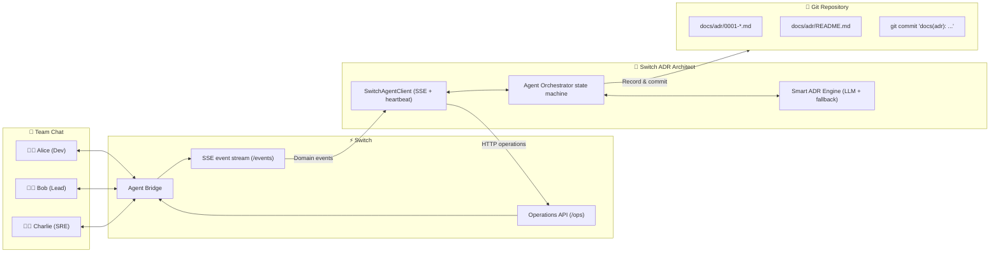

# 🏛️ Switch ADR Architect: Multiplayer Architecture Decision Records in Team Chat

> **Built for the "Flip the Switch" Hackathon** (WeMakeDevs × DevTools Academy)
> *Transforming casual chat debates into authoritative Git ADRs through open-source Switch infrastructure.*

[](LICENSE)
[](https://github.com/sandbox-quantum/switch)
[](https://adr.github.io/madr/)
[](test_e2e.py)

---

## 💡 The Problem

Engineering teams make critical architectural decisions every day in chat channels (Mattermost, Slack, Discord). They debate databases, caching strategies, messaging queues, and authentication schemes.

**Then consensus evaporates.** Nobody writes the Architecture Decision Record (ADR), nobody documents the rollback strategy, and six months later the team asks: *"Why did we choose this database again?"*

Traditional ADR tools require developers to leave chat, open a terminal, remember Markdown templates, and write files in isolation.

## 🚀 The Solution: Switch ADR Architect

**Switch ADR Architect** brings an active AI architect into your team chat room using **Switch**.

1. **Ambient Room Awareness**: The agent sits in `#architecture-review` alongside engineers via Switch.
2. **Context Synthesis**: When tagged (`@architect summarize and draft an ADR`), the agent reads the room's timeline through Switch's `read_context` operation.
3. **Guardrail Gap Detection**: It detects missing architectural requirements — **rollback strategies**, **operational trade-offs**, and **unexamined alternatives**.
4. **Chat-Native Clarification**: It asks clarifying questions directly in the chat thread and waits for a teammate's answer.
5. **Autonomous Git Persistence**: Once clarified or approved, it compiles an official [MADR 3.0](https://adr.github.io/madr/) document, updates `docs/adr/README.md`, and commits the decision directly to Git.
6. **Smarter synthesis**: ADR text is produced by an LLM through any OpenAI-compatible endpoint when `ADR_API_KEY` is set. Without a key — or if the provider fails — the agent degrades to a deterministic keyword engine, so the demo and tests never require network access.

---

## 🔑 Why Switch is Indispensable

This project **cannot function without Switch**:

* **Multi-Human, Single-Agent Room State**: Individual terminal agents (Claude Code, Cursor, Copilot) are trapped in one user's session. Switch provides the room topology where several humans debate and one agent listens with shared context.
* **Bi-directional Agent Protocol**: The agent relies on Switch's SSE event stream (`GET /agents/{id}/events`) for room events and the operations API (`POST /agents/{id}/ops/...`) to claim a room, read context, and post replies.
* **Connection Liveness**: A client-generated connection id plus a 2-second heartbeat (`POST /agents/{id}/connection/beat`) keeps the agent live; the client resumes from its cursor (`Last-Event-ID`) after a dropped socket.
* **Channel Agnostic**: Runs identically across **Mattermost** (bundled with Switch), **Slack**, **Discord**, or **Teams** without changing agent code.
* **Automation without a separate bot platform**: Switch resolves the room, participant names, addressing (`@architect`), and identity — the agent only implements its ADR workflow.

---

## 🏗️ System Architecture



---

## 🎬 Chat Flow in Action

```text
[#architecture-review]
Alice:   "Team, we need to decide on our primary database for the telemetry pipeline."
Bob:     "I propose we choose PostgreSQL with TimescaleDB because it is mature and supports fast SQL queries."
Charlie: "The trade-off is dedicated vacuum tuning and partition management overhead."
Alice:   "Alternative was ClickHouse, but team has zero ClickHouse operations experience."

Alice:   "@architect summarize our discussion and draft an ADR."

Architect: "🏛️ I analyzed the team discussion for Selection of Database for System Architecture.
            Before recording to git, please clarify:
            1. What is the rollback or mitigation plan if this decision encounters failure in production?"

Bob:     "@architect In case of failure, our rollback strategy is falling back to managed Aurora read-replicas."

Architect: "🏛️ All clarifications received. Decision recorded! 🎉
            - 📄 Document: docs/adr/0002-selection-of-database-for-system-architecture.md
            - 🔀 Git Commit: docs(adr): record ADR-0002: Selection of Database for System Architecture

            Rollback Strategy: In case of failure, our rollback strategy is falling back to managed
            Aurora read-replicas."
```

The agent also ignores follow-up chatter in a thread after recording an ADR (for 5 minutes) so one debate cannot produce duplicate records. Say `@architect new ADR ...` to start a fresh decision in the same room.

---

## 📦 Directory Structure

```text
flipswitch/
├── switch-template.yaml      # Official Switch agent template (v2) for Switch Console
├── main.py                   # CLI: --simulate, --interactive, --embedded, live mode
├── switch_client.py          # Switch Agent Protocol client (SSE /events, heartbeat, ops)
├── switch_simulator.py       # Zero-dependency mock Switch bridge for instant evaluation
├── agent_orchestrator.py     # Multi-turn state machine, gap loop, Git persistence
├── adr_engine.py             # MADR 3.0 renderer + deterministic keyword analysis
├── llm_engine.py             # Smart LLM-backed analysis with heuristic fallback
├── test_e2e.py               # End-to-end, protocol contract, duplicate-guard suite (6 tests)
├── requirements.txt          # requests>=2.31.0
├── .env.example              # Optional smart-model configuration
├── docs/LIVE_SWITCH_SETUP.md # Register an agent + find the room UUID on a real server
└── docs/adr/                 # Generated ADRs + auto-generated index
```

---

## 🚀 Getting Started

### Prerequisites
* Python 3.10+
* Git installed and configured locally (`user.name` / `user.email`)

### 1. Installation
```bash
git clone https://github.com/sebin-gg/flipswitch.git
cd flipswitch
pip install -r requirements.txt
```

### 2. Run the instant demo (no external setup)
```bash
python main.py --simulate
```
This starts an embedded mock Switch bridge, streams a real room discussion between Alice, Bob, and Charlie, has Alice summon `@architect`, answers the rollback question, and commits the generated ADR to your repository.

### 3. Chat with the agent yourself
```bash
python main.py --interactive
```
Type messages as a teammate (for example `We should use Redis for session caching`) and then `@architect create ADR`. Type `exit` to stop.

### 4. Enable the smarter model (optional)
The agent works offline with heuristics. To let an LLM synthesize the ADR:
```bash
export ADR_API_KEY=sk-...            # or OPENAI_API_KEY
export ADR_MODEL=gpt-4.1             # any chat-completions model
export ADR_LLM_BASE_URL=https://api.openai.com/v1   # or any compatible endpoint
python main.py --simulate
```
Check which engine is active with `python main.py --list-models`. Force the offline engine with `--no-llm` (useful for judging and CI). See `.env.example`.

### 5. Connect to a live Switch instance
Full walkthrough, including the exact `curl` calls and troubleshooting:
**[docs/LIVE_SWITCH_SETUP.md](docs/LIVE_SWITCH_SETUP.md)**. The short version:

1. Point at the **agent bridge** base URL (switch-core), not the Gateway UI, and confirm it:
   ```bash
   curl -s "$BRIDGE_URL/health"   # 200 = right base URL, 401 = right host/wrong path
   ```
2. Register the agent once with a registration token (not an API key). The
   returned `api_key` is shown **once**, and the returned `id` — not the name —
   is what goes in `--agent-id`:
   ```bash
   curl -X POST "$BRIDGE_URL/agents/register-known" \
     -H "Authorization: Bearer $AGENT_REGISTRATION_TOKEN" \
     -H "Content-Type: application/json" \
     -d '{"agent_type":"always_on","name":"architect","description":"ADR Architect","options":{}}'
   ```
3. Add the agent to the room, and widen **who can talk to it** — new agents
   start owner-only and will otherwise ignore teammates.
4. Read the room UUID from the agent's own room list (only rooms it belongs to):
   ```bash
   curl -s -X POST "$BRIDGE_URL/agents/$SWITCH_AGENT_ID/ops/list_rooms" \
     -H "Authorization: Bearer $SWITCH_AGENT_KEY" \
     -H "Content-Type: application/json" -d '{}'
   # -> {"result":[{"room_id":"<uuid>","name":"...",...}]}
   ```
5. Run it (a room name also works, but a UUID survives a rename):
   ```bash
   python main.py --bridge-url "$BRIDGE_URL" --agent-id "$SWITCH_AGENT_ID" \
     --api-key "$SWITCH_AGENT_KEY" --room "<room-uuid>"
   ```
6. In the room, debate a decision and mention `@architect summarize and draft an ADR`.

The agent claims the room with `connect_to_room`, so `post_message` and `read_context` operate on that room implicitly, exactly as the Switch operations API expects. Run one instance per agent id: a second claim takes the room over and the two evict each other.

### 6. Or install it from the Switch template
1. Open **Switch Console** → **Agents** → **Install Template**.
2. Select `switch-template.yaml`.

---

## 🧪 Running Automated Tests

```bash
python -m unittest test_e2e.py -v
```

Covers:
1. Bridge health and connection.
2. Full flow: discussion → gap question → teammate answer → MADR file → index update → git commit.
3. Smart-engine fallback when no API key exists and when the provider is unreachable.
4. Protocol contract: a strict bridge rejects any operation argument outside the published signature (no `room_id` on `post_message`, no `room_id` on named-room context reads) and asserts the client streams from `GET /agents/{id}/events`, never the legacy `/stream` path.
5. Duplicate guard: after a decision is recorded, follow-up chatter in the same thread creates no new ADR file or commit (it replies “already recorded”), while an explicit `@architect new ADR ...` still records a new decision.

Expected:
```text
Ran 6 tests in ~14s
OK
```

The suite uses an ephemeral port and a project-local `test_sandbox/` directory, so it is portable and leaves no state behind.

---

## 🔍 Protocol Notes (why the client is written this way)

| Concern | Implementation |
|:--|:--|
| Downstream | `GET /agents/{agent_id}/events?connection_id=…&scope=all&filter=all` |
| Upstream | `POST /agents/{agent_id}/ops/{operation}` with `X-Switch-Connection-Id` |
| Liveness | `POST /agents/{agent_id}/connection/beat` every 2s; 404/409 reopens the stream |
| Resume | Client keeps `Last-Event-ID` / `cursor` across reconnects |
| Room binding | `connect_to_room` then implicit room on `post_message` / `read_context` |
| Threads | `read_context` threads are flattened oldest-first; replies use the real message id |

`switch_simulator.py` mirrors the same endpoints, including `/events`, heartbeats, room binding, and thread-shaped `read_context` responses, so the demo exercises the production code path rather than a mock shortcut.

---

## 📄 License

MIT License. Built for the WeMakeDevs × DevTools Academy Switch Hackathon 2026.
