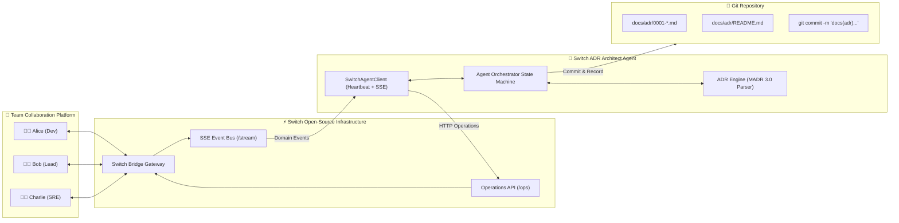

# 🏛️ Switch ADR Architect: Multiplayer Architecture Decision Records in Team Chat

> **Built for the "Flip the Switch" Hackathon** (WeMakeDevs × DevTools Academy)  
> *Transforming casual chat debates into authoritative, peer-reviewed Git ADRs through open-source Switch infrastructure.*

[](LICENSE)
[](https://github.com/sandbox-quantum/switch)
[](https://adr.github.io/madr/)
[](test_e2e.py)

---

## 💡 The Problem

Engineering teams make critical architectural decisions every day in chat channels (Mattermost, Slack, Discord). They debate databases, caching strategies, messaging queues, and authentication schemes.

**Then consensus evaporates.** Nobody writes the Architecture Decision Record (ADR), nobody documents the rollback strategy, and six months later the team asks: *"Why did we choose this database again?"*

Traditional ADR tools require developers to leave chat, open terminal, remember Markdown templates, and write files in isolation.

## 🚀 The Solution: Switch ADR Architect

**Switch ADR Architect** brings an active, autonomous AI architect into your team chat room using **Switch**. 

1. **Ambient Room Awareness**: The agent sits in `#architecture` alongside engineers via Switch.
2. **Context Synthesis**: When tagged (`@architect summarize and draft ADR`), the agent reads the room's discussion history via Switch's `read_context` operation.
3. **Guardrail Gap Detection**: It detects missing architectural requirements — specifically **rollback strategies**, **operational overheads**, and **alternative trade-offs**.
4. **Chat-Native Clarification**: It asks clarifying questions directly in the chat thread.
5. **Autonomous Git Persistence**: Once clarified or approved, it compiles an official [MADR 3.0](https://adr.github.io/madr/) Markdown document, updates `docs/adr/README.md`, and commits the decision directly to the Git repository.

---

## 🔑 Why Switch is Indispensable

This project **cannot function without Switch**:

* **Multi-Human, Single-Agent Room State**: Individual AI agents (Claude Code, Cursor, Copilot) are trapped in single-user terminals. Switch provides the room topology where multiple humans (Alice, Bob, Charlie) debate and a single agent listens and responds in shared context.
* **Bi-directional Wire Protocol**: The agent relies on Switch's Server-Sent Events (SSE) stream (`GET /agents/{id}/stream`) for real-time room notifications and HTTP operations (`POST /agents/{id}/ops/post_message`, `POST /agents/{id}/ops/read_context`) to interact with the room.
* **Channel Agnostic**: Runs identically across **Mattermost** (bundled with Switch), **Slack**, **Discord**, or **Teams** without changing agent code.

---

## 🏗️ System Architecture



---

## 🎬 Chat Flow in Action

```text
[#architecture-review]
Alice:   "Team, we need to decide on our primary database for the telemetry pipeline."
Bob:     "I propose we choose PostgreSQL with TimescaleDB because it is mature and supports fast SQL queries."
Charlie: "The trade-off is dedicated vacuum tuning and partition management overhead."
Alice:   "Alternative was ClickHouse, but team has zero ClickHouse operations experience."

Alice:   "@architect summarize our discussion and draft an ADR."

Architect: "🏛️ ADR Architect: I analyzed your discussion on Selection of Database.
            Before recording to git, please clarify:
            1. What is the rollback plan if TimescaleDB encounters failure in production?"

Bob:     "@architect In case of failure, our rollback plan is falling back to managed Aurora read-replicas."

Architect: "🏛️ ADR Architect: All clarifications received. Decision recorded! 🎉
            - 📄 Document: docs/adr/0001-selection-of-database-for-system-architecture.md
            - 🔀 Git Commit: docs(adr): record ADR-0001: Selection of Database
            
            ### Final Decision Summary:
            > Bob: I propose PostgreSQL with TimescaleDB...
            Rollback Strategy: Revert DNS to Aurora read-replica."
```

---

## 📦 Directory Structure

```text
flipswitch/
├── switch-template.yaml      # Official Switch Agent Template (v2 specification)
├── main.py                   # CLI entrypoint (Demo, Interactive, and Live modes)
├── switch_client.py          # Switch Wire Protocol client (SSE down, HTTP ops up)
├── switch_simulator.py       # Zero-dependency Switch Mock Bridge for instant evaluation
├── agent_orchestrator.py     # Multi-turn state machine & Git persistence manager
├── adr_engine.py             # MADR 3.0 parser, gap detector, and markdown renderer
├── test_e2e.py               # Automated end-to-end test suite
├── requirements.txt          # Minimal dependency declaration (requests)
└── docs/
    └── adr/                  # Target destination for generated ADRs
        └── README.md         # Auto-generated table of contents
```

---

## 🚀 Getting Started

### Prerequisites
* Python 3.10+
* Git installed and configured locally

### 1. Installation
```bash
git clone https://github.com/your-username/flipswitch.git
cd flipswitch
pip install -r requirements.txt
```

### 2. Run Instant Automated Demo (No External Setup Required)
To see the full collaborative room discussion, question-asking, and Git commit executed live:
```bash
python main.py --simulate
```
*Spins up an embedded Switch Bridge, streams the conversation between Alice, Bob, and the Architect, and commits the generated ADR to your repository.*

### 3. Run in Interactive Chat Mode
Want to chat with the agent yourself in terminal as a team member?
```bash
python main.py --interactive
```
*Type messages like `We should use Redis for session caching` followed by `@architect create ADR`.*

### 4. Connect to Live Switch Instance (Mattermost / Slack / Discord)
If you have a live Switch server running (`http://localhost:8000` or hosted):
```bash
python main.py --bridge-url http://localhost:8000 --agent-id architect --api-key YOUR_SWITCH_KEY --room "#architecture"
```

Or deploy using the included template with Switch Console:
1. Open **Switch Console**.
2. Go to **Agents** → **Install Template**.
3. Select `switch-template.yaml`.

---

## 🧪 Running Automated Tests

Run the end-to-end verification test suite:
```bash
python -m unittest test_e2e.py
```

Output:
```text
Ran 2 tests in 5.3s
OK
```

---

## 📄 License

MIT License. Built for the WeMakeDevs × DevTools Academy Switch Hackathon 2026.
